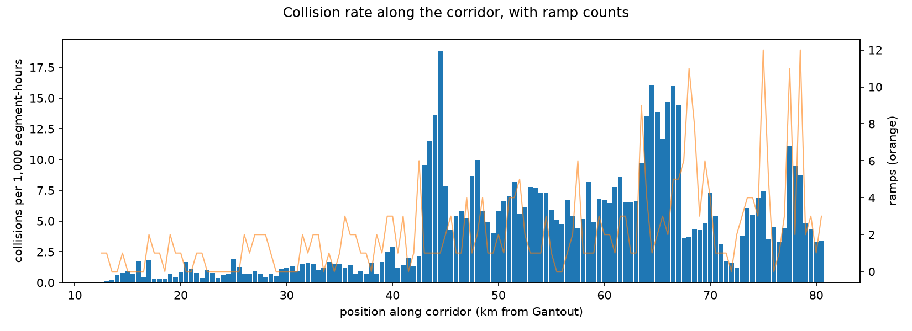
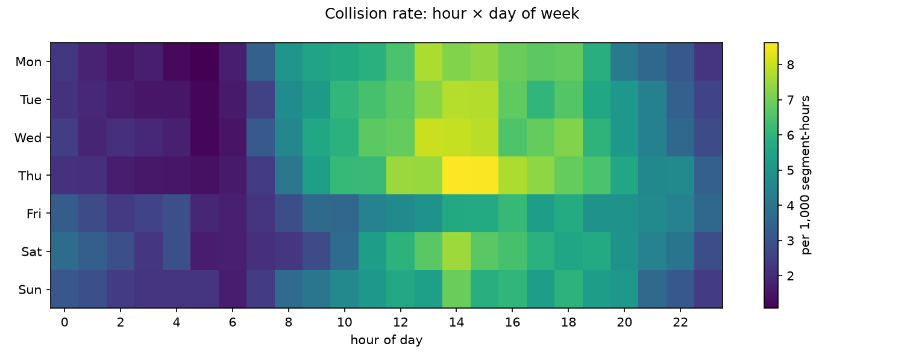
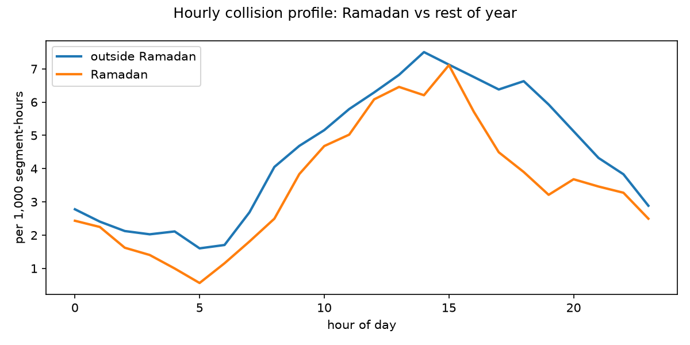

# SAFAR: Spatial Accident Forecasting Across Roads

An hourly collision-risk forecasting system for Sheikh Zayed Road (E11), Dubai. Every hour it scores each 500 m
stretch of a 68 km corridor for the chance of a recorded collision in the next hour, so the riskiest stretches can be
ranked ahead of time.

> **This is a write-up of a private repository.** The code depends on an incident dataset that can't be published,
> so the source stays private. This page summarises what was built, how it was evaluated and what it found.

**Stack:** Python · scikit-learn (HistGradientBoosting) · pandas / PyArrow · GeoPandas / Shapely · OpenStreetMap ·
Open-Meteo weather and air-quality APIs · Docker

## At a glance

| | |
|---|---|
| Incident records cleaned and mapped | **726,028** (Aug 2018 – Jul 2026) |
| Road modelled | E11, 137 segments of ~500 m, **68.6 km** |
| Training panel | **8.8 million** segment-hours, ~94 columns |
| Collision hours in the panel | 38,584 (base rate 0.4% per segment-hour) |
| Evaluation | Year-by-year chronological holdout, paired day-block bootstrap |
| Regression tests | 64 |

## What it does

1. **Road geometry.** Pulls E11 from OpenStreetMap, joins it into one reference line and cuts it into ~500 m segments
   with road attributes (lanes, speed limit, ramps, junctions).
2. **Incident mapping.** Assigns each incident to its nearest segment within 250 m and removes 210 days with reporting
   gaps, so a missing record isn't counted as a safe hour.
3. **Panel.** Builds one row for every segment and every hour, including hours with no collision, with calendar
   (Ramadan, Eid, school terms, weekends), weather, air-quality and dust, road and past-collision features.
   Every feature is checked to use only information available before the hour it predicts.
4. **Models.** Two gradient-boosted classifiers: one uses recent collision history, one doesn't (for when the
   incident feed is behind).
5. **Hourly scorer.** A command-line job fetches live weather, builds the same features, picks the right model and
   writes 137 scores for the next full hour. Each run is logged with model and data hashes, so the forecasts can be
   scored later against what actually happened.

## Results

When the model's top 5 segments each hour are flagged (5 of 137, about 3.6% of the road), they contain **13% of the
hour's collisions**, **3.6× what random picks would catch**. The top 10 contain 24% (3.2× random).

Average precision (AP) by evaluation year, against a baseline that predicts each segment's historical rate for that
hour of the week:

| Evaluation period | Historical-rate baseline | Model, no incident history | Model, with incident history |
|---|---:|---:|---:|
| 2022 | 0.0085 | 0.0122 | 0.0127 |
| 2023 | 0.0090 | 0.0126 | 0.0130 |
| 2024 | 0.0099 | 0.0124 | 0.0123 |
| 2025 – Jul 2026 (retrospective) | 0.0097 | 0.0123 | 0.0127 |

Both models beat the raw baseline in every year, at about 3× the base rate.

### What it found

The most useful result came from testing the models against a stronger baseline:

- **A smoothed historical baseline nearly matches the model.** Smoothing each segment's hour-of-week rate towards
  overall patterns raised the baseline's AP from 0.0091 to 0.0124. The boosted models are within about 4% of it, and
  a paired bootstrap couldn't show they're reliably better. Most of the risk on this road is *where* and *when*, and
  that's already in the history.
- **Weather adds no measurable value** for this road at this resolution. Taking it out slightly improved the score in
  every year, though not by enough to be significant.
- **Less history hurts.** Training only from 2020 or 2021, or weighting recent years more, was the same or worse.
- **Noise from refitting the same model is as large as most of these effects** (about ±0.0001–0.0002 AP), so smaller
  gains weren't counted as improvements.
- **Coarser units (1 km, 3 h) didn't help**, and collisions can't be assigned to a direction of travel because the two
  carriageways are only ~29 m apart and the data has no heading.

The conclusion was that the next real gain needs a new kind of input: traffic volume. A TomTom traffic-flow collector
is built, but not enough data has been collected yet to use it in a model.

Every variant was decided in advance with a fixed rule for adopting one: the 95% interval must exclude zero in at
least 2 of 3 validation years, and the direction must agree in all 3. None met it, so the deployed models were left
unchanged.

## Patterns in the data

**Risk along the corridor.** Collision rate per 500 m segment; the orange line is ramp count. Several of the peaks line
up with stretches that have many ramps.

**Time of week.** The weekday early-afternoon peak is about 8× the overnight low.

**Ramadan.** During Ramadan the rate falls sharply after 15:00 and the usual 18:00 peak disappears.

## Engineering

- **No data leakage.** An audit step checks every partition of the panel for labels, keys, lags and history that
  could see the future, and records a fingerprint of the panel.
- **Reproducible.** The full panel was rebuilt from scratch with newly downloaded weather and matched the saved
  fingerprints exactly; saved evaluation scores reproduced with zero difference. A locked environment and a Docker
  image give the same build on any machine.
- **Live and training features match.** A parity check rebuilds features for a past hour through the live scorer
  and compares them with the training panel value by value.
- **Recorded decisions.** 12 design records (corridor choice, segmentation, leakage control, evaluation, the v3
  experiments) and a dated review log of defects found and fixed.
- **Honest claims.** Results from periods that had already been inspected are labelled retrospective, and
  replaying past hours with the final model isn't counted as accuracy.

## Limits

- Predicts *recorded* collisions, which aren't a complete count of real crashes.
- No traffic-volume input yet; weather comes from five points along the corridor, not every segment.
- The scorer is a command-line job; there's no deployed scheduler, dashboard or live incident feed, and
  accuracy on real future hours hasn't been measured yet.

## Data credits

Road geometry © OpenStreetMap contributors (ODbL). Weather and air quality from
[Open-Meteo](https://open-meteo.com/) (CC BY 4.0).
